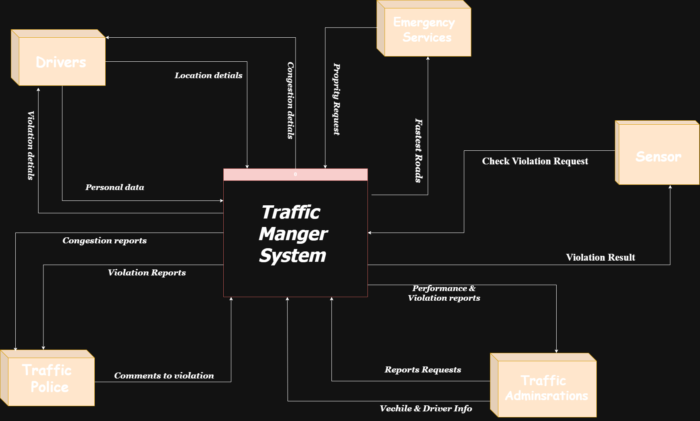
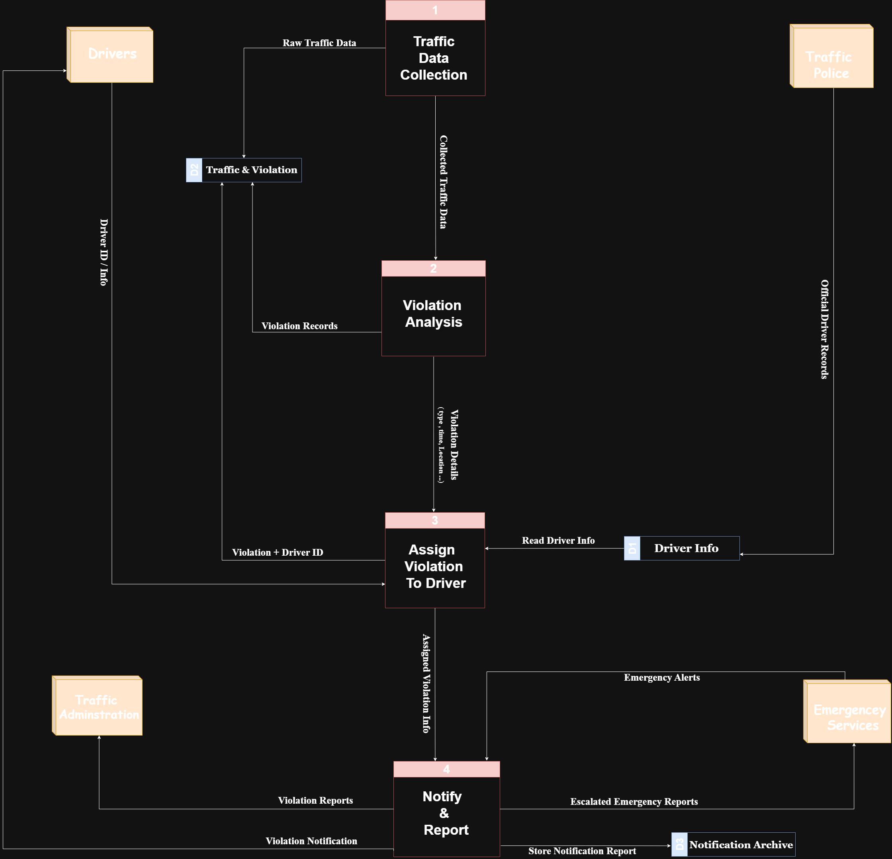
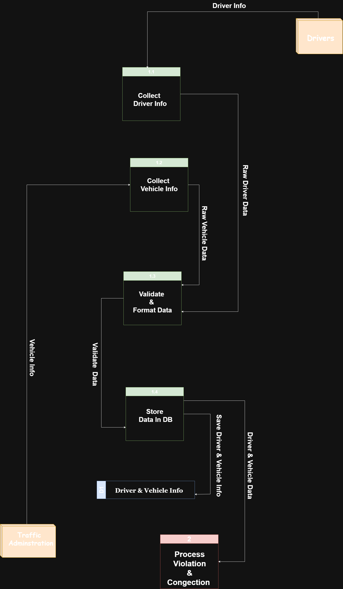
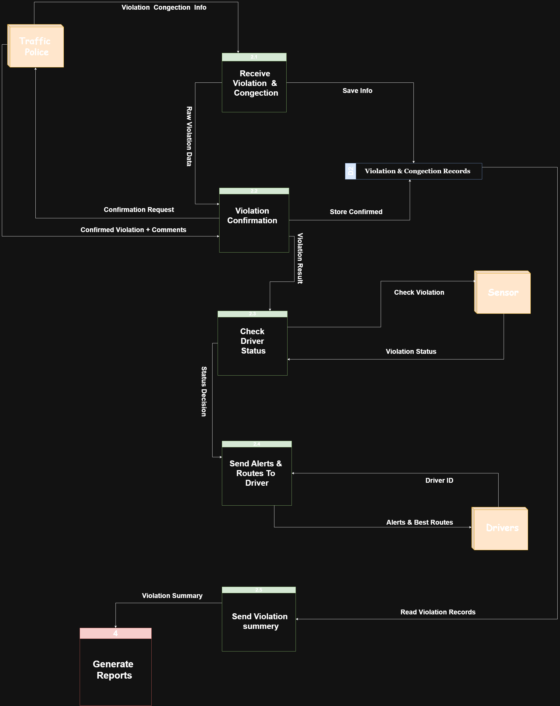
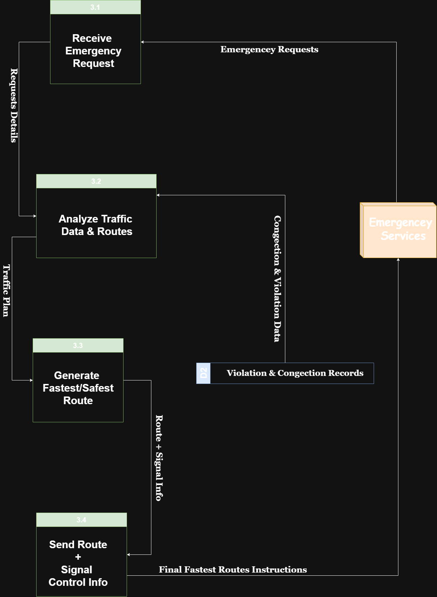
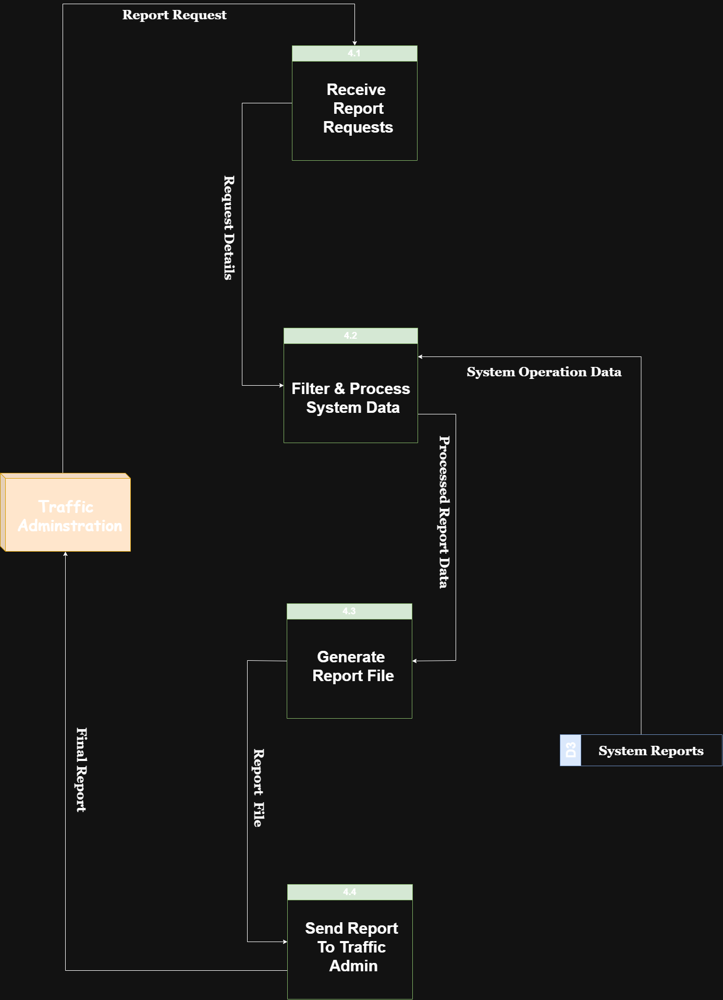
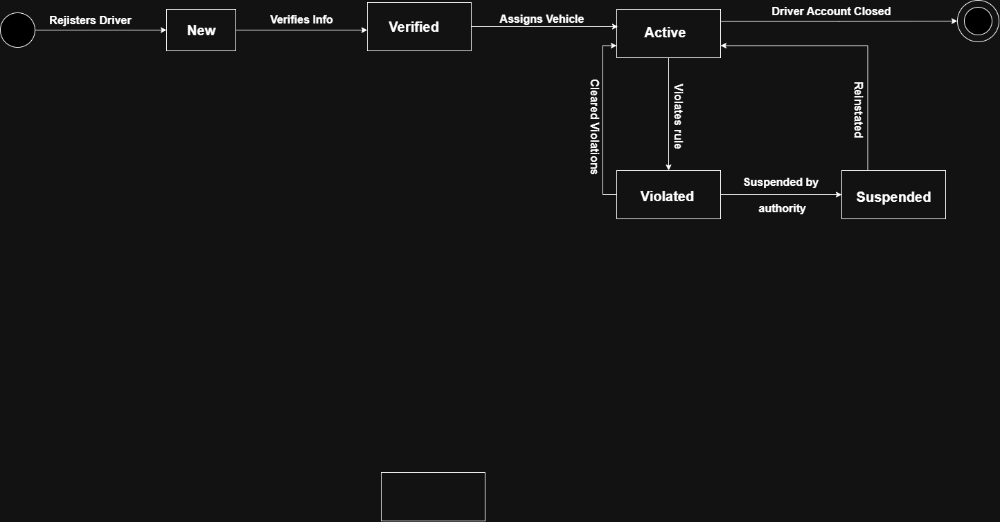
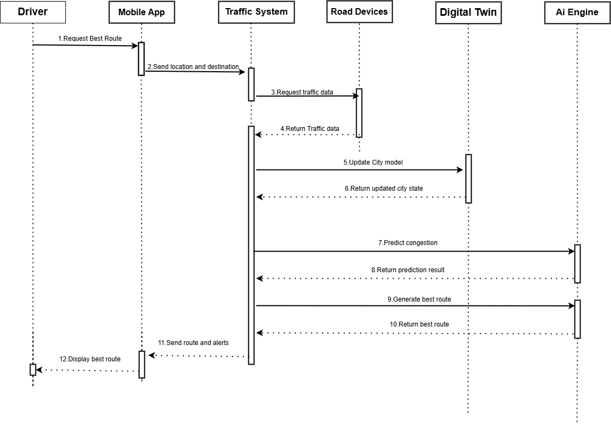
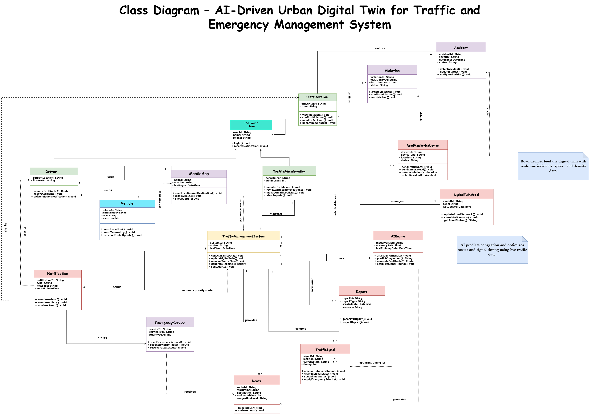
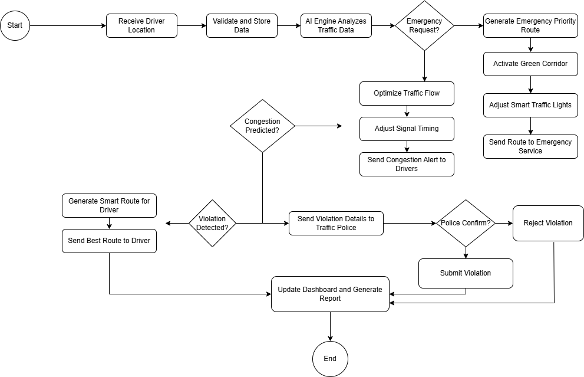

# Smart Traffic Manager (STM)

### System Analysis and Design Project

A Software Engineering project focused on analyzing, modeling, and designing a Smart Traffic Management System using structured system analysis methodologies, data flow modeling, and Unified Modeling Language (UML).

---

## 1. Project Overview

Smart Traffic Manager (STM) is an academic System Analysis and Design project that focuses on analyzing and modeling a proposed smart traffic management system.

The project applies software engineering methodologies to understand system requirements, identify external entities, analyze data movement, define system processes, and represent system structure and behavior through different modeling techniques.

It aims to transform system requirements into structured models that describe the system's boundaries, workflows, transactions, interactions, and internal architecture.

## 2. Project Objectives

* Analyze and document system requirements.
* Identify system actors and external entities.
* Define functional and non-functional requirements.
* Represent system boundaries and external interactions.
* Model data movement and information processing.
* Analyze system processes and transaction flows.
* Design the system structure using UML.
* Represent system behavior and component interactions.
* Apply software engineering principles throughout the design process.

## 3. System Analysis and Modeling

The project covers several fundamental areas of System Analysis and Design:

* Requirements Engineering.
* Functional Requirements Analysis.
* Non-Functional Requirements Analysis.
* Context and System Boundary Modeling.
* Data Flow Analysis.
* Process Decomposition.
* Transaction Modeling.
* Structural Modeling.
* Behavioral Modeling.
* UML-Based System Design.

---

## 4. System Diagrams and Modeling

This section presents the system analysis and design models developed for the Smart Traffic Manager project.

### 4.1 Context Diagram

Provides a high-level representation of the system, illustrating its boundaries and interactions with external entities.



### 4.2 Data Flow Diagrams (DFD)

Data Flow Diagrams illustrate how information moves throughout the system, including external entities, processes, data stores, and data flows.

#### DFD Level 0

Provides a high-level representation of the main system processes and data flows.



#### DFD Level 1

Decomposes the main system processes into more detailed subprocesses and illustrates their internal data flows.


#### Lower-Level DFDs

Provide further decomposition of selected system processes, presenting their internal operations, subprocesses, and detailed data flows.

**Lower-Level DFD 1**



**Lower-Level DFD 2**



**Lower-Level DFD 3**



**Lower-Level DFD 4**



### 4.3 Transaction Diagram

Illustrates the transaction structure and the different transaction paths or operations within the proposed system.



---

## 5. UML Diagrams

The project uses four fundamental UML diagrams to represent the structural and behavioral aspects of the proposed system.

### 5.1 Use Case Diagram

Describes the system's functional requirements and illustrates the interactions between external actors and the system.


### 5.2 Sequence Diagram

Illustrates the interactions and communication between actors and system components over time, showing the sequence of messages exchanged during specific operations.



### 5.3 Class Diagram

Represents the static structure of the system, including classes, attributes, operations, and relationships.



### 5.4 Activity Diagram

Visualizes system workflows through activities, decisions, and execution paths, illustrating how different processes are performed.



---

## 6. Project Documentation

The complete project documentation and supporting analysis are available in PDF format.

| Document                                                             | Description                               |
| -------------------------------------------------------------------- | ----------------------------------------- |
| [Project Documentation](Documentation/STM-Project-Documentation.pdf) | Complete project documentation.           |
| [System Analysis](Documentation/STM-System-Analysis.pdf)             | Supporting system analysis documentation. |

---

## 7. Tools and Concepts

The project applies the following software engineering concepts and modeling techniques:

* System Analysis and Design.
* Requirements Engineering.
* Unified Modeling Language (UML).
* Data Flow Diagrams (DFD).
* Context Diagram Modeling.
* Transaction Modeling.
* Structural and Behavioral Modeling.
* Software Engineering Methodologies.

---

## 8. Repository Structure

```text
Smart-Traffic-Manager-STM/
│
├── README.md
│
├── Diagrams/
│   │
│   ├── Context-Diagram.png
│   │
│   ├── DFD/
│   │   ├── DFD-Level-0.png
│   │   ├── DFD-Level-1.png
│   │   │
│   │   └── Lower-Level/
│   │       ├── Lower-Level-1.png
│   │       ├── Lower-Level-2.png
│   │       ├── Lower-Level-3.png
│   │       └── Lower-Level-4.png
│   │
│   ├── Transaction-Diagram.png
│   │
│   └── UML/
│       ├── Use-Case-Diagram.png
│       ├── Sequence-Diagram.png
│       ├── Class-Diagram.png
│       └── Activity-Diagram.png
│
├── Documentation/
│   ├── STM-Project-Documentation.pdf
│   └── STM-System-Analysis.pdf
│
└── LICENSE
```

---

## 9. Project Information

| Attribute        | Details                                             |
| ---------------- | --------------------------------------------------- |
| Project Name     | Smart Traffic Manager (STM)                         |
| Project Category | Software Engineering                                |
| Academic Subject | System Analysis and Design                          |
| Main Focus       | System Analysis, Data Flow Modeling, and UML Design |
| Project Type     | Academic Project                                    |

---

## 10. Contributors

Developed as part of an academic project in System Analysis and Design.

---

<p align="center">
  <strong>Smart Traffic Manager (STM)</strong>
  <br>
  <em>From Requirements Analysis to System Design.</em>
</p>
