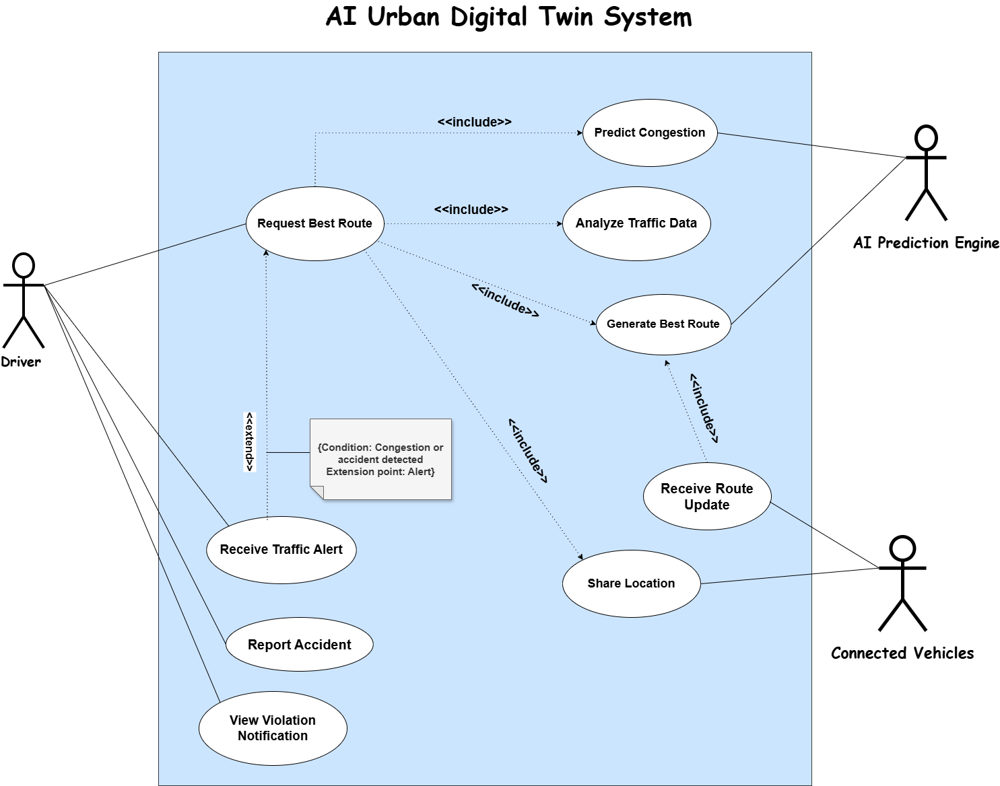
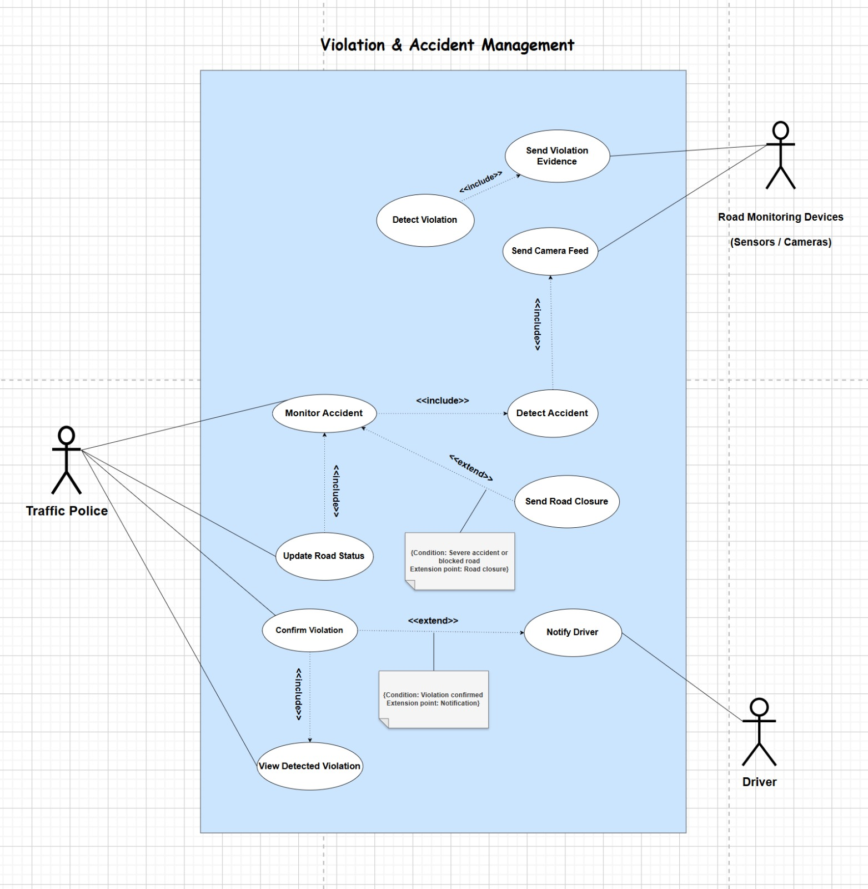
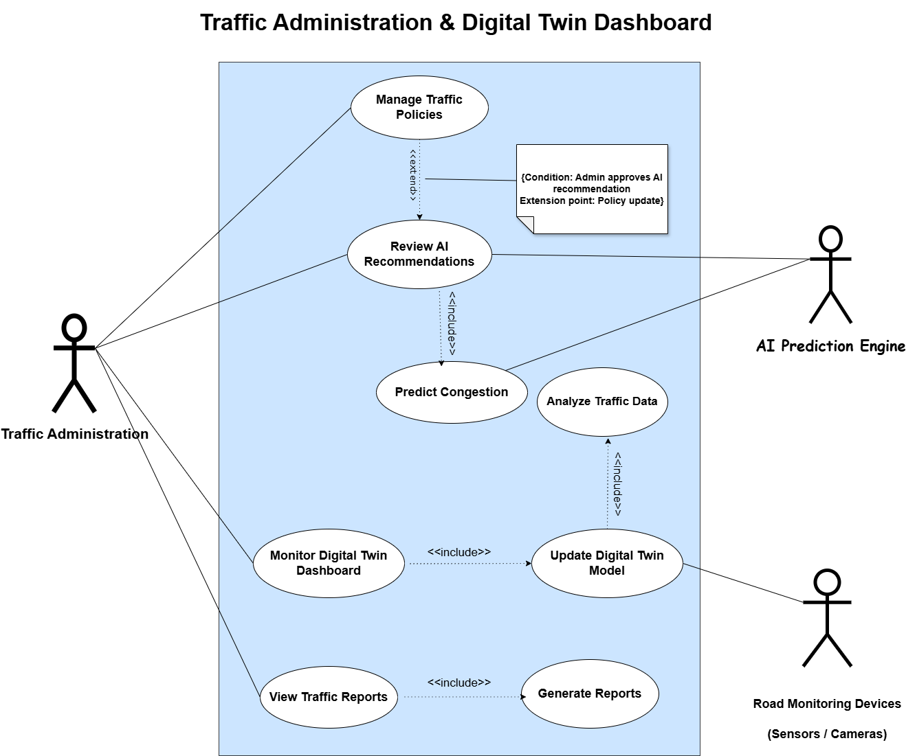
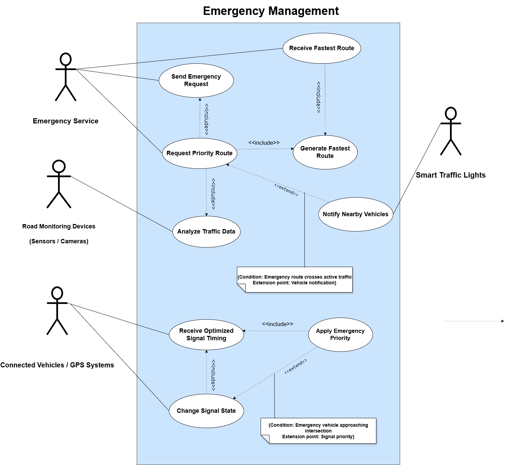
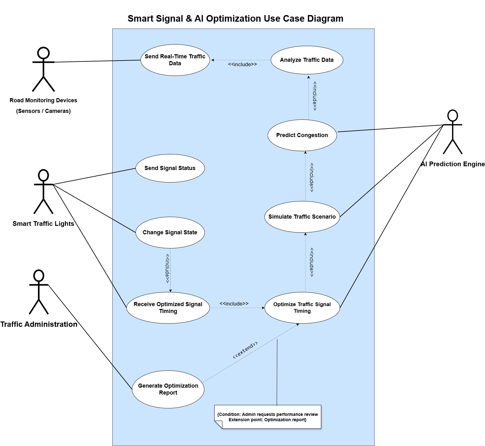

# 🚦 Smart Traffic Manager (STM)

<p align="center">
  <strong>A System Analysis and Design Project</strong>
  <br>
  <em>Modeling a Smart Traffic Management System</em>
</p>

<p align="center">
  
  
  
  
</p>

---

## 📑 Table of Contents

* [Project Overview](#-project-overview)
* [Project Objectives](#-project-objectives)
* [System Analysis and Modeling](#-system-analysis-and-modeling)
* [System Diagrams](#-system-diagrams)

  * [Context Diagram](#1-context-diagram)
  * [Data Flow Diagrams](#2-data-flow-diagrams-dfd)
  * [Transaction Diagram](#3-transaction-diagram)
* [UML Diagrams](#-uml-diagrams)

  * [Use Case Diagrams](#4-use-case-diagrams)
  * [Sequence Diagram](#5-sequence-diagram)
  * [Class Diagram](#6-class-diagram)
  * [Activity Diagram](#7-activity-diagram)
* [Project Documentation](#-project-documentation)
* [Tools and Concepts](#-tools-and-concepts)
* [Repository Structure](#-repository-structure)
* [Project Information](#-project-information)
* [Contributors](#-contributors)

---

## 📌 Project Overview

**Smart Traffic Manager (STM)** is an academic project developed as part of the **System Analysis and Design** course.

The project focuses on analyzing, studying, and modeling a proposed Smart Traffic Management System using structured software engineering methodologies.

It covers the fundamental stages of system analysis and design, starting with system definition, requirements analysis, feasibility study, and fact-finding activities, followed by system modeling and documentation.

The project aims to transform the collected information and identified requirements into structured models that represent the system's boundaries, processes, data flows, transactions, interactions, and internal architecture.

This repository contains the project's analysis documentation, system diagrams, UML models, and supporting project materials.

---

## 🎯 Project Objectives

The main objectives of this project are:

* Analyze and document the requirements of a Smart Traffic Management System.
* Define the proposed system and understand its scope.
* Identify system actors, stakeholders, and external entities.
* Study the feasibility of the proposed system.
* Apply fact-finding techniques to collect and analyze system information.
* Represent system boundaries and external interactions.
* Model information movement and system processes.
* Analyze transaction flows and system operations.
* Represent system behavior and interactions using UML.
* Define structural relationships between system components.
* Apply software engineering principles throughout the system design process.

---

## 🧩 System Analysis and Modeling

The project applies several fundamental concepts and techniques of System Analysis and Design.

| Area                  | Description                                                          |
| --------------------- | -------------------------------------------------------------------- |
| System Definition     | Defines the proposed system, its purpose, and scope.                 |
| Requirements Analysis | Identifies and analyzes the system requirements.                     |
| Feasibility Study     | Evaluates the feasibility of the proposed system.                    |
| Fact-Finding          | Collects relevant system information using two fact-finding methods. |
| Context Modeling      | Defines the system boundary and external interactions.               |
| Data Flow Analysis    | Represents how information moves throughout the system.              |
| Process Decomposition | Breaks down selected processes into more detailed subprocesses.      |
| Transaction Modeling  | Represents transaction-related operations and flows.                 |
| Structural Modeling   | Describes the system structure and relationships.                    |
| Behavioral Modeling   | Represents system activities and interactions using UML.             |

---

## 📊 System Diagrams

This section presents the system analysis models developed to describe the structure, processes, and information flows of the proposed Smart Traffic Manager system.

### 1. Context Diagram

The Context Diagram provides a high-level overview of the Smart Traffic Manager system.

It illustrates the system boundary and the interactions between the system and its external entities.

<p align="center">
  
</p>

---

### 2. Data Flow Diagrams (DFD)

Data Flow Diagrams illustrate how information moves throughout the system, including external entities, processes, data stores, and data flows.

#### DFD Level 0

Provides a high-level representation of the system's main processes and data flows.

<p align="center">
  
</p>

#### Lower-Level DFDs

Provide further decomposition of selected system processes, illustrating their internal operations, subprocesses, and detailed data flows.

<details>
<summary><strong>📄 Lower-Level DFD 1</strong></summary>
<br>
<p align="center">
  
</p>
</details>

<details>
<summary><strong>📄 Lower-Level DFD 2</strong></summary>
<br>
<p align="center">
  
</p>
</details>

<details>
<summary><strong>📄 Lower-Level DFD 3</strong></summary>
<br>
<p align="center">
  
</p>
</details>

<details>
<summary><strong>📄 Lower-Level DFD 4</strong></summary>
<br>
<p align="center">
  
</p>
</details>

---

### 3. Transaction Diagram

The Transaction Diagram illustrates the transaction structure and the different transaction paths or operations within the proposed system.

<p align="center">
  
</p>

---

## 🔷 UML Diagrams

The project uses four fundamental UML diagram types to represent the functional, structural, and behavioral aspects of the proposed system.

### 4. Use Case Diagrams

The Use Case Diagrams describe the system's functional requirements and illustrate the interactions between external actors and the functionalities provided by the Smart Traffic Manager system.

<details>
<summary><strong>📄 Use Case Diagram 1</strong></summary>
<br>
<p align="center">
  
</p>
</details>

<details>
<summary><strong>📄 Use Case Diagram 2</strong></summary>
<br>
<p align="center">
  
</p>
</details>

<details>
<summary><strong>📄 Use Case Diagram 3</strong></summary>
<br>
<p align="center">
  
</p>
</details>

<details>
<summary><strong>📄 Use Case Diagram 4</strong></summary>
<br>
<p align="center">
  
</p>
</details>

<details>
<summary><strong>📄 Use Case Diagram 5</strong></summary>
<br>
<p align="center">
  
</p>
</details>

### 5. Sequence Diagram

The Sequence Diagram illustrates the interactions and communication between actors and system components over time, showing the sequence of messages exchanged during specific operations.

<p align="center">
  
</p>

### 6. Class Diagram

The Class Diagram represents the static structure of the system, including classes, attributes, operations, and relationships.

<p align="center">
  
</p>

### 7. Activity Diagram

The Activity Diagram visualizes system workflows through activities, decisions, and execution paths, illustrating how different processes are performed.

<p align="center">
  
</p>

---

## 📚 Project Documentation

The project documentation provides detailed information about the system analysis, feasibility study, requirements definition, fact-finding activities, and supporting system models.

| Document                                                                     | Description                                                                                                                                 |
| ---------------------------------------------------------------------------- | ------------------------------------------------------------------------------------------------------------------------------------------- |
| [Project Documentation](Documentation/STM-Project-Documentation.pdf)         | Contains the main project documentation and supporting project details.                                                                     |
| [System Analysis & Feasibility Study](Documentation/STM-System-Analysis.pdf) | Covers system analysis, system definition, feasibility study, fact-finding using two methods, and the related analysis and design diagrams. |

---

## 🛠 Tools and Concepts

The project applies the following software engineering concepts and modeling techniques:

### System Analysis & Design

* System Definition
* Requirements Engineering
* Functional Requirements Analysis
* Non-Functional Requirements Analysis
* Feasibility Study
* Fact-Finding Techniques
* System Modeling
* Process Decomposition

### Diagramming & Modeling

* Context Diagram Modeling
* Data Flow Diagrams (DFD)
* Unified Modeling Language (UML)
* Use Case Modeling
* Sequence Modeling
* Class Modeling
* Activity Modeling
* Transaction Modeling
* Structural and Behavioral Modeling

---

## 📁 Repository Structure

The repository is organized into separate directories for system diagrams, UML models, and project documentation.

```text
Smart-Traffic-Manager-STM/
│
├── README.md
│
├── Diagrams/
│   │
│   ├── Context-Diagram.png
│   │
│   ├── DFD/
│   │   ├── DFD-Level-0.png
│   │   │
│   │   └── Lower-Level/
│   │       ├── Lower-Level-1.png
│   │       ├── Lower-Level-2.png
│   │       ├── Lower-Level-3.png
│   │       └── Lower-Level-4.png
│   │
│   ├── Transaction-Diagram.png
│   │
│   └── UML/
│       ├── Use-Case-Diagram-1.png
│       ├── Use-Case-Diagram-2.png
│       ├── Use-Case-Diagram-3.png
│       ├── Use-Case-Diagram-4.png
│       ├── Use-Case-Diagram-5.png
│       ├── Sequence-Diagram.png
│       ├── Class-Diagram.png
│       └── Activity-Diagram.png
│
├── Documentation/
│   ├── STM-Project-Documentation.pdf
│   └── STM-System-Analysis.pdf
│
└── LICENSE
```

---

## ℹ️ Project Information

| Attribute            | Details                                          |
| -------------------- | ------------------------------------------------ |
| Project Name         | Smart Traffic Manager (STM)                      |
| Project Category     | Software Engineering                             |
| Academic Subject     | System Analysis and Design                       |
| Project Type         | Academic Project                                 |
| Main Focus           | System Analysis, Feasibility Study, DFD, and UML |
| Documentation Format | PDF                                              |
| Repository Purpose   | Academic Documentation and Portfolio             |

---

## 👥 Contributors

This project was developed collaboratively as part of an academic project in System Analysis and Design.

* **Riyad Ayman**
* **Zaid El-Bahgy**
* **Mohamed El-Hadry**

---

<p align="center">
  <strong>Smart Traffic Manager (STM)</strong>
  <br>
  <em>From System Analysis to Structured Design.</em>
  <br><br>
  <sub>Academic Software Engineering Project</sub>
</p>
